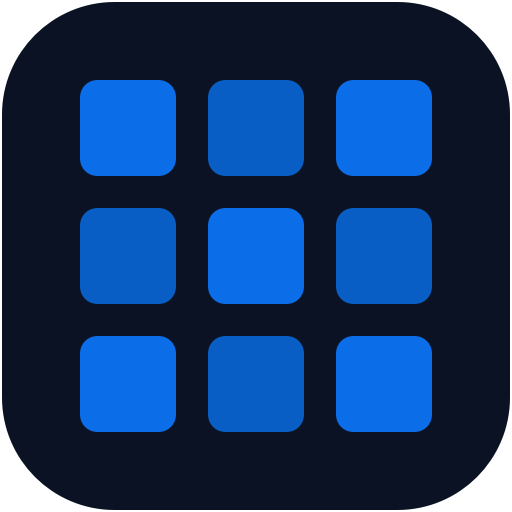
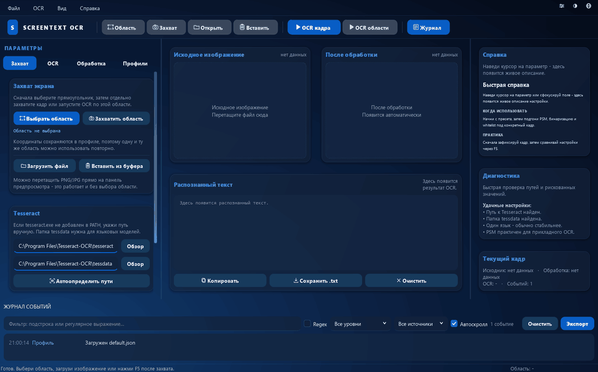
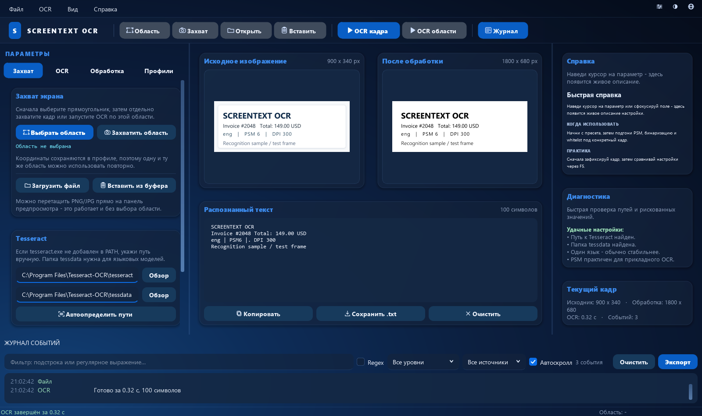
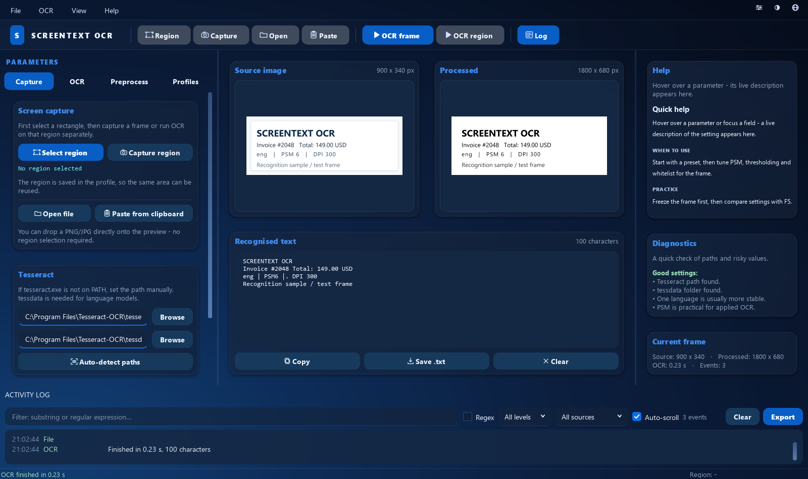
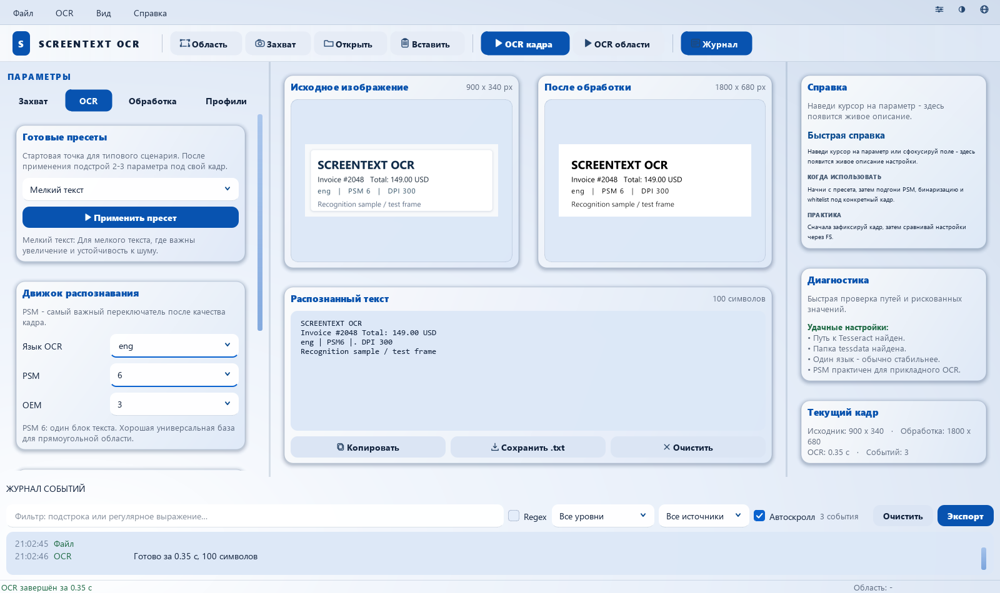

<p align="center">
  
</p>

# ScreenText OCR

Распознаёт текст с экрана Windows и кладёт его в буфер обмена. Работает локально через Tesseract 5.

Extracts text from the Windows screen and puts it on the clipboard. Runs locally through Tesseract 5.

[Русский](#русский) | [English](#english)


***

# Русский

## Содержание

- [Что делает](#что-делает)
- [Установка и запуск](#установка-и-запуск)
- [Быстрый старт](#быстрый-старт)
- [Ограничения и известные проблемы](#ограничения-и-известные-проблемы)
- [English](#english)

## Что делает

Приложение работает на Windows 10 и 11. Вы выделяете прямоугольник на экране или загружаете изображение. Приложение показывает исходный кадр и кадр после обработки, затем передаёт обработанный кадр установленному в системе `tesseract.exe` 5.x. Интерфейс построен на PyQt5. Обработка изображений использует OpenCV. Собственного OCR-движка нет. Распознавание выполняет Tesseract. Один кадр за раз, без пакетного режима и фоновых сервисов. Сетевого кода нет. Версия 2.2.0.

### Демонстрация

Захват области, запуск OCR и готовый текст. Записано на Windows 11 с Tesseract 5.









## Возможности

- выбор прямоугольной области мышью на виртуальном рабочем столе, включая несколько мониторов и отрицательные координаты;
- захват кадра без OCR и повторное распознавание уже зафиксированного кадра;
- загрузка изображения из файла, из буфера обмена или перетаскиванием на превью;
- распознавание в фоновом потоке, интерфейс не блокируется;
- пять пресетов: `single_digit_strict`, `digits`, `strict_ui`, `small_text`, `chat_text`;
- настройка языка OCR, PSM, OEM, whitelist и blacklist, DPI и дополнительных флагов Tesseract;
- автопоиск `tesseract.exe` и `tessdata`, диагностика показывает, каких файлов не хватает;
- JSON-профили с параметрами OCR и координатами области;
- интерфейс на русском и английском, тёмная и светлая темы;
- журнал событий с фильтрами и экспортом в CSV или TXT;
- один экземпляр приложения: повторный запуск поднимает открытое окно.

## Установка и запуск

Нужны Python 3.10 или новее и Tesseract 5. Интерфейс по умолчанию открывается на английском.

```powershell
git clone https://github.com/Golyb0u/ScreenText-OCR.git
cd ScreenText-OCR
python -m venv .venv
.\.venv\Scripts\Activate.ps1
pip install -r requirements.txt
python main.py
```

Русский интерфейс: `python main.py --lang ru`.

Установка как пакета:

```powershell
pip install .
screentext-ocr
```

`screentext-ocr-gui` запускает приложение без окна консоли.

### Структура проекта

Корень репозитория:

```text
ScreenText-OCR/
├── .github/
├── configs/
│   └── default.json
├── docs/
│   ├── demo.gif
│   ├── logo.png
│   ├── sample-text.png
│   └── screenshots/
│       ├── 01-dark-ru.png
│       ├── 02-dark-en.png
│       └── 03-light.png
├── screentext_ocr/
│   ├── __init__.py
│   ├── app.py
│   ├── config.py
│   ├── i18n.py
│   ├── imaging.py
│   ├── migration.py
│   ├── ocr.py
│   ├── singleton.py
│   ├── translations_en.py
│   ├── worker.py
│   └── ui/
│       ├── __init__.py
│       ├── activity.py
│       ├── appearance.py
│       ├── card_paint.py
│       ├── card_reorder.py
│       ├── grid_card_reorder.py
│       ├── help.py
│       ├── help_texts.py
│       ├── help_texts_en.py
│       ├── icons.py
│       ├── main_window.py
│       ├── region_overlay.py
│       ├── theme.py
│       ├── widgets.py
│       └── pages/
│           ├── __init__.py
│           ├── capture_page.py
│           ├── ocr_page.py
│           ├── preprocess_page.py
│           ├── profiles_page.py
│           └── preview_panel.py
├── main.py
├── pyproject.toml
├── requirements.txt
├── ScreenTextOCR.spec
├── README.md
├── CHANGELOG.md
├── CONTRIBUTING.md
├── SECURITY.md
├── LICENSE
└── .gitignore
```

Каталоги `build` и `dist` создаются при сборке и в репозиторий не входят.

## Настройка Tesseract

1. Установите Tesseract 5. На Windows обычно берут сборку UB Mannheim.
2. Проверьте установку командами `tesseract --version` и `tesseract --list-langs`.
3. Если `tesseract.exe` не найден в `PATH`, укажите путь на вкладке `Захват`. Обычно это `C:\Program Files\Tesseract-OCR\tesseract.exe`.
4. Папка `tessdata` лежит рядом с `tesseract.exe`, обычно это `C:\Program Files\Tesseract-OCR\tessdata`. Для русского языка нужен `rus.traineddata`. Файл можно взять из официального репозитория `tessdata`. Диагностика сообщит об отсутствующем файле.

### Язык OCR

Список языков в поле `Язык OCR` фиксированный и редактируемый: `eng`, `rus`, `eng+rus`, `deu`, `fra`, `spa`. Приложение не читает `tessdata` при заполнении списка и не добавляет установленные языки само. Список задаёт отправную точку. Другой код можно ввести вручную.

Если путь к `tessdata` указан, перед запуском OCR приложение проверяет файлы `*.traineddata` для выбранных языков и предупреждает об отсутствующих.

## Параметры командной строки

| Флаг | Действие |
| --- | --- |
| `--light` | светлая палитра при старте |
| `--dark` | тёмная палитра при старте |
| `--system` | не применять QSS, оставить системный стиль |
| `--profile NAME` | загрузить `configs/NAME.json` |
| `--lang ru\|en` | язык интерфейса |

В репозитории есть только `configs/default.json`, поэтому рабочий пример: `python main.py --lang en --profile default`. Полный список флагов выводит `python main.py --help`.

## Переменные окружения

| Переменная | Назначение | По умолчанию |
| --- | --- | --- |
| `SCREENTEXT_CONFIG_DIR` | каталог с профилями `*.json` | `configs` в корне проекта |
| `SCREENTEXT_SETTINGS` | путь к INI-файлу QSettings | системные настройки Qt |
| `SCREENTEXT_LANG` | язык интерфейса при старте | `en` |
| `SCREENTEXT_NO_RESTART` | значение `1` отключает перезапуск при смене языка | не задана |
| `TESSDATA_PREFIX` | каталог с файлами `*.traineddata` | определяется автоматически |

Старые имена `TESSERACT_STUDIO_*` (`CONFIG_DIR`, `SETTINGS`, `LANG`, `NO_RESTART`) работают как запасной вариант и считаются устаревшими. Пример для PowerShell: `$env:SCREENTEXT_LANG = "ru"`.

Если пакет установлен через `pip install .`, профили хранятся в `%LOCALAPPDATA%\ScreenTextOCR\configs`. В сборке exe используется папка `configs` рядом с `ScreenTextOCR.exe`.

## Быстрый старт

1. Запустите `python main.py`. Для русского интерфейса добавьте `--lang ru`.
2. Откройте вкладку `Захват` и нажмите `Выбрать область`. Выделите прямоугольник. На этом шаге сохраняются только координаты, кадра ещё нет.
3. Нажмите `Захватить область` или `F6`. Появится кадр области. Второй вариант: пропустите этот шаг и нажмите `Ctrl+Enter`, тогда OCR сам захватит область по сохранённым координатам.
4. Откройте вкладку `OCR`, выберите пресет и при необходимости поправьте язык, PSM, OEM и whitelist.
5. Откройте вкладку `Обработка` и проверьте панель `После обработки`. Именно это изображение получит Tesseract.
6. Нажмите `F5` или `Распознать кадр`.
7. Текст появится в блоке `Распознанный текст`. Его можно править, копировать через `Ctrl+Shift+C` или сохранить в `.txt` через `Ctrl+S`.

## Интерфейс

- Верхняя панель: кнопки области, захвата, открытия файла, вставки, OCR кадра и области, журнала.
- Правый верхний угол строки меню: кнопки оформления, темы и переключатель языка.
- Левая панель: вкладки `Захват`, `OCR`, `Обработка`, `Профили`.
- Центр и правая панель: карточки исходного кадра, обработанного кадра, распознанного текста, справки и диагностики.
- Нижний док: журнал событий с фильтрами и экспортом.

### Язык интерфейса

Язык переключается через меню кнопки с глобусом в правом верхнем углу строки меню либо флагом `--lang`. Выбор сохраняется между запусками. При смене языка приложение перезапускается, чтобы все страницы и подсказки были собраны заново. Переменная `SCREENTEXT_NO_RESTART=1` отключает перезапуск.

## Горячие клавиши

| Клавиши | Действие |
| --- | --- |
| `Ctrl+Shift+R` | выбрать область |
| `F6` | захватить область |
| `F5` | распознать текущий кадр |
| `Ctrl+Enter` | распознать область, зарегистрировано как `Ctrl+Return` |
| `Ctrl+O` | открыть изображение |
| `Ctrl+Shift+V` | вставить из буфера |
| `Ctrl+Shift+C` | копировать распознанный текст |
| `Ctrl+S` | сохранить текст |
| `Ctrl+Shift+E` | экспортировать журнал |
| `Ctrl+T` | сменить палитру |
| `Ctrl+,` | оформление |
| `Ctrl+J` | журнал событий |
| `Ctrl+L` | очистить журнал |
| `Ctrl+/` | список горячих клавиш |
| `F1` | о программе |
| `Esc` | закрыть окно |

## Профили

Профиль хранится в JSON-файле в `configs/`. В нём записаны язык, PSM и OEM, параметры предобработки, whitelist и blacklist, DPI, дополнительные флаги Tesseract и координаты области. В репозитории есть только `configs/default.json`.

Флаг `--profile NAME` читает `configs/NAME.json`. Имя указывается без пути: `--profile default`.

В интерфейсе профиль можно загрузить, сохранить под новым именем, обновить список и открыть папку профилей. При первом запуске версии 2.2 профили из `%LOCALAPPDATA%\TesseractStudio\configs` копируются в новый каталог. Оригиналы остаются на месте.

## Примеры использования

Запуск приложения из кода:

```python
from screentext_ocr.app import main

raise SystemExit(main(["--lang", "en", "--profile", "default"]))
```

Прямой вызов OCR-модуля:

```python
from dataclasses import asdict

import cv2

from screentext_ocr.config import AppConfig
from screentext_ocr.ocr import recognize

settings = AppConfig(scale=3.0, threshold_mode="otsu", language="eng", psm=6)
processed, text = recognize(cv2.imread("docs/sample-text.png"), asdict(settings))
print(text)
```

## Сборка exe

```powershell
pip install pyinstaller
pyinstaller ScreenTextOCR.spec
```

Готовый файл появится в `dist/ScreenTextOCR.exe`. В сборку входит `configs/default.json`. Tesseract в неё не входит и устанавливается отдельно.

## Ограничения и известные проблемы

- Приложение работает только на Windows 10 и 11. На других платформах оно не собирается и не проверяется.
- Tesseract устанавливается отдельно, в exe его нет.
- Обрабатывается один кадр за раз. Пакетного режима нет.
- При масштабе Windows 125-150% координаты области могут смещаться. После смены масштаба область нужно выбрать заново.
- Смена языка перезапускает приложение. Несохранённый текст может потеряться.
- Список языков OCR фиксированный. Приложение не сканирует `tessdata`. Если нужного файла нет, OCR не запустится: приложение покажет предупреждение.
- `preserve_spaces` добавляет к вызову Tesseract флаг `-c preserve_interword_spaces=1`. Это сохраняет пробелы между словами, но не убирает жёсткие переносы строк.
- OCR читает символы, а не разметку. Отступы в коде после вставки обычно приходится поправлять.
- `Ctrl+Enter` зарегистрирован как `Ctrl+Return`. Работа с цифрового блока не проверялась.

## Частые проблемы

| Проблема | Что сделать |
| --- | --- |
| `Tesseract не найден` | указать `tesseract.exe` на вкладке `Захват` или добавить его в `PATH` |
| `В tessdata нет rus.traineddata` | скачать `rus.traineddata` в `tessdata` или выбрать `eng` |
| После выбора области `F5` не запускает OCR | нажать `F6` для захвата кадра или `Ctrl+Enter` для OCR области |
| OCR возвращает мусор | проверить `После обработки`, PSM, масштаб и whitelist |
| Область смещена | при масштабе 125-150% выбрать область заново |
| Текст слишком мелкий | поднять `scale` до 2.0-4.0 и DPI до 300 |
| Журнал пуст | открыть док `Журнал событий` через `Ctrl+J` |

## Планы

- [ ] Пакетная обработка нескольких файлов
- [ ] Экспорт в PDF и DOCX
- [ ] Распознавание с видеопотока
- [ ] Плагины пользовательских предобработчиков
- [ ] Дополнительные языки интерфейса

## Автор и лицензия

Автор: Golyb0u.

- Репозиторий: https://github.com/Golyb0u/ScreenText-OCR
- Релизы: https://github.com/Golyb0u/ScreenText-OCR/releases
- Issues: https://github.com/Golyb0u/ScreenText-OCR/issues
- Discussions: https://github.com/Golyb0u/ScreenText-OCR/discussions

Лицензия MIT, текст в [LICENSE](LICENSE). Правила участия в [CONTRIBUTING.md](CONTRIBUTING.md), сообщения об уязвимостях в [SECURITY.md](SECURITY.md).

***

# English

## Contents

- [What it does](#what-it-does)
- [Install and run](#install-and-run)
- [Quick start](#quick-start)
- [Limitations and known issues](#limitations-and-known-issues)
- [Русский](#русский)

## What it does

The app runs on Windows 10 and 11. You select a rectangle on screen or load an image. The app shows the source frame and the processed frame, then passes the processed frame to the installed `tesseract.exe` 5.x. The interface is built with PyQt5. Image processing uses OpenCV. There is no OCR engine of its own. Recognition is done by Tesseract. One frame at a time, no batch mode and no background services. There is no network code. Version 2.2.0.

### Demo

Region capture, OCR and the resulting text, recorded on Windows 11 with Tesseract 5.


## Features

- rectangle selection on the virtual desktop, including multiple monitors and negative coordinates;
- capture without OCR and repeat OCR on the same frozen frame;
- image from a file, the clipboard or drag and drop onto the preview;
- OCR on a worker thread, the window stays responsive;
- five presets: `single_digit_strict`, `digits`, `strict_ui`, `small_text`, `chat_text`;
- OCR language, PSM, OEM, whitelist and blacklist, DPI and extra Tesseract flags;
- automatic discovery of `tesseract.exe` and `tessdata`, diagnostics report missing files;
- JSON profiles with OCR settings and region coordinates;
- Russian and English interface, dark and light themes;
- activity log with filters and CSV or TXT export;
- single instance: a second launch brings the open window to the front.

## Install and run

Python 3.10+ and Tesseract 5 are required. The interface starts in English.

```powershell
git clone https://github.com/Golyb0u/ScreenText-OCR.git
cd ScreenText-OCR
python -m venv .venv
.\.venv\Scripts\Activate.ps1
pip install -r requirements.txt
python main.py
```

Russian interface: `python main.py --lang ru`.

Install as a package:

```powershell
pip install .
screentext-ocr
```

`screentext-ocr-gui` starts the same app without a console window.

### Project layout

Repository root:

```text
ScreenText-OCR/
├── .github/
├── configs/
│   └── default.json
├── docs/
│   ├── demo.gif
│   ├── logo.png
│   ├── sample-text.png
│   └── screenshots/
│       ├── 01-dark-ru.png
│       ├── 02-dark-en.png
│       └── 03-light.png
├── screentext_ocr/
│   ├── __init__.py
│   ├── app.py
│   ├── config.py
│   ├── i18n.py
│   ├── imaging.py
│   ├── migration.py
│   ├── ocr.py
│   ├── singleton.py
│   ├── translations_en.py
│   ├── worker.py
│   └── ui/
│       ├── __init__.py
│       ├── activity.py
│       ├── appearance.py
│       ├── card_paint.py
│       ├── card_reorder.py
│       ├── grid_card_reorder.py
│       ├── help.py
│       ├── help_texts.py
│       ├── help_texts_en.py
│       ├── icons.py
│       ├── main_window.py
│       ├── region_overlay.py
│       ├── theme.py
│       ├── widgets.py
│       └── pages/
│           ├── __init__.py
│           ├── capture_page.py
│           ├── ocr_page.py
│           ├── preprocess_page.py
│           ├── profiles_page.py
│           └── preview_panel.py
├── main.py
├── pyproject.toml
├── requirements.txt
├── ScreenTextOCR.spec
├── README.md
├── CHANGELOG.md
├── CONTRIBUTING.md
├── SECURITY.md
├── LICENSE
└── .gitignore
```

The `build` and `dist` folders appear after a build and are not part of the repository.

## Tesseract setup

1. Install Tesseract 5. The UB Mannheim build is the usual choice on Windows.
2. Check the installation with `tesseract --version` and `tesseract --list-langs`.
3. If `tesseract.exe` is not on `PATH`, set the path on the `Capture` tab. It is usually `C:\Program Files\Tesseract-OCR\tesseract.exe`.
4. The `tessdata` folder sits next to `tesseract.exe`, usually `C:\Program Files\Tesseract-OCR\tessdata`. Russian OCR needs `rus.traineddata` in that folder. The file can be downloaded from the official `tessdata` repository. Diagnostics report the missing file.

### OCR language

The language field is a fixed, editable list: `eng`, `rus`, `eng+rus`, `deu`, `fra`, `spa`. The app does not scan `tessdata` to fill the list and does not add installed languages on its own. The list is a starting point. Another code can be typed by hand.

When a `tessdata` path is set, the app checks the `*.traineddata` files for the selected languages before OCR and warns about missing ones.

## Command-line flags

| Flag | Effect |
| --- | --- |
| `--light` | start with the light palette |
| `--dark` | start with the dark palette |
| `--system` | do not apply QSS, keep the system style |
| `--profile NAME` | load `configs/NAME.json` |
| `--lang ru\|en` | interface language |

Only `configs/default.json` ships with the repository, so a working example is `python main.py --lang en --profile default`. The full list is printed by `python main.py --help`.

## Environment variables

| Variable | Purpose | Default |
| --- | --- | --- |
| `SCREENTEXT_CONFIG_DIR` | directory with `*.json` profiles | `configs` in the project root |
| `SCREENTEXT_SETTINGS` | path to the QSettings INI file | system Qt settings |
| `SCREENTEXT_LANG` | interface language at startup | `en` |
| `SCREENTEXT_NO_RESTART` | `1` disables the restart on a language change | unset |
| `TESSDATA_PREFIX` | directory with `*.traineddata` files | detected automatically |

The old `TESSERACT_STUDIO_*` names (`CONFIG_DIR`, `SETTINGS`, `LANG`, `NO_RESTART`) still work as a fallback and are deprecated. PowerShell example: `$env:SCREENTEXT_LANG = "ru"`.

When the package is installed with `pip install .`, profiles live in `%LOCALAPPDATA%\ScreenTextOCR\configs`. The exe build uses the `configs` folder next to `ScreenTextOCR.exe`.

## Quick start

1. Run `python main.py`. Add `--lang ru` for the Russian interface.
2. Open `Capture` and click `Select region`. Drag a rectangle. This step stores coordinates only, there is no frame yet.
3. Click `Capture region` or press `F6` to freeze the region. Alternative: skip this step and press `Ctrl+Enter`, then OCR captures the region using the stored coordinates.
4. Open `OCR`, pick a preset and adjust language, PSM, OEM and whitelist if needed.
5. Open `Preprocess` and check `Processed`. That is the image Tesseract receives.
6. Press `F5` or click `Run OCR`.
7. The text appears in `Recognised text`. Edit it, copy it with `Ctrl+Shift+C` or save it to `.txt` with `Ctrl+S`.

## Interface

- Top bar: buttons for region, capture, open, paste, OCR of the frame and region, and the log.
- Top right of the menu bar: appearance, theme and the language switch.
- Left panel: `Capture`, `OCR`, `Preprocess` and `Profiles` tabs.
- Center and right panel: cards for the source frame, processed frame, recognised text, help and diagnostics.
- Bottom dock: activity log with filters and export.

### Interface language

Switch the language from the globe menu in the top right of the menu bar or with `--lang`. The choice is saved between launches. Changing the language restarts the app so every page and hint is rebuilt. `SCREENTEXT_NO_RESTART=1` disables the restart.

## Keyboard shortcuts

| Keys | Action |
| --- | --- |
| `Ctrl+Shift+R` | select region |
| `F6` | capture region |
| `F5` | OCR the current frame |
| `Ctrl+Enter` | OCR the selected region, registered as `Ctrl+Return` |
| `Ctrl+O` | open image |
| `Ctrl+Shift+V` | paste from clipboard |
| `Ctrl+Shift+C` | copy recognised text |
| `Ctrl+S` | save text |
| `Ctrl+Shift+E` | export the activity log |
| `Ctrl+T` | toggle palette |
| `Ctrl+,` | appearance |
| `Ctrl+J` | activity log |
| `Ctrl+L` | clear log |
| `Ctrl+/` | shortcut list |
| `F1` | about |
| `Esc` | close window |

## Profiles

A profile is a JSON file in `configs/`. It stores the language, PSM and OEM, preprocessing values, whitelist and blacklist, DPI, extra Tesseract flags and the region coordinates. Only `configs/default.json` ships with the repository.

`--profile NAME` reads `configs/NAME.json`. The name is given without a path: `--profile default`.

The interface can load a profile, save it under a new name, refresh the list and open the profiles folder. On the first 2.2 launch, profiles from `%LOCALAPPDATA%\TesseractStudio\configs` are copied to the new directory. The originals stay in place.

## Usage examples

Launch the app from code:

```python
from screentext_ocr.app import main

raise SystemExit(main(["--lang", "en", "--profile", "default"]))
```

Call the OCR module directly:

```python
from dataclasses import asdict

import cv2

from screentext_ocr.config import AppConfig
from screentext_ocr.ocr import recognize

settings = AppConfig(scale=3.0, threshold_mode="otsu", language="eng", psm=6)
processed, text = recognize(cv2.imread("docs/sample-text.png"), asdict(settings))
print(text)
```

## Building the exe

```powershell
pip install pyinstaller
pyinstaller ScreenTextOCR.spec
```

The executable is written to `dist/ScreenTextOCR.exe`. `configs/default.json` is included. Tesseract is not included and is installed separately.

## Limitations and known issues

- The app runs on Windows 10 and 11 only. It is not built or checked on other platforms.
- Tesseract is installed separately and is not bundled into the exe.
- One frame is processed at a time. There is no batch mode.
- At 125-150% Windows scaling the region coordinates may be offset. Select the region again after a scaling change.
- Changing the language restarts the app. Unsaved text may be lost.
- The OCR language list is fixed. The app does not scan `tessdata`. If the needed file is absent, OCR does not start and the app shows a warning.
- `preserve_spaces` adds the Tesseract flag `-c preserve_interword_spaces=1`. It keeps spaces between words. It does not remove hard line breaks.
- OCR reads glyphs, not markup. Indentation in code usually needs fixing after a paste.
- `Ctrl+Enter` is registered as `Ctrl+Return`. The numeric keypad has not been checked.

## Common problems

| Problem | Fix |
| --- | --- |
| `Tesseract not found` | set `tesseract.exe` on the `Capture` tab or add it to `PATH` |
| `rus.traineddata` missing | download `rus.traineddata` into `tessdata`, or use `eng` |
| `F5` after selecting a region does not start OCR | press `F6` to capture the frame, or `Ctrl+Enter` to OCR the region |
| OCR output is garbage | inspect `Processed`, then tune PSM, scale and whitelist |
| Region is offset | at 125-150% scaling, select the region again |
| Text is too small | raise `scale` to 2.0-4.0 and DPI to 300 |
| Activity log stays empty | open the `Activity log` dock with `Ctrl+J` |

## Roadmap

- [ ] Batch processing of multiple files
- [ ] Export to PDF and DOCX
- [ ] Recognition from a video stream
- [ ] Plugins for custom preprocessors
- [ ] Additional interface languages

## Author and license

Author: Golyb0u.

- Repository: https://github.com/Golyb0u/ScreenText-OCR
- Releases: https://github.com/Golyb0u/ScreenText-OCR/releases
- Issues: https://github.com/Golyb0u/ScreenText-OCR/issues
- Discussions: https://github.com/Golyb0u/ScreenText-OCR/discussions

MIT license, see [LICENSE](LICENSE). Contribution rules are in [CONTRIBUTING.md](CONTRIBUTING.md), vulnerability reports in [SECURITY.md](SECURITY.md).
